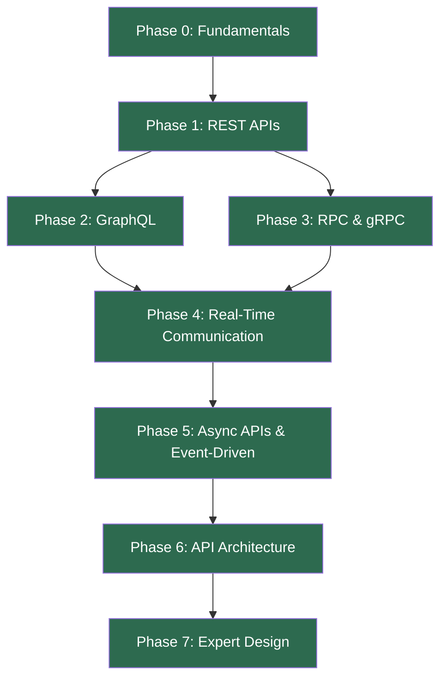
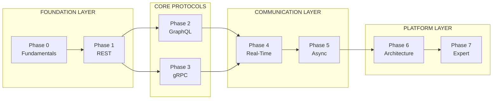
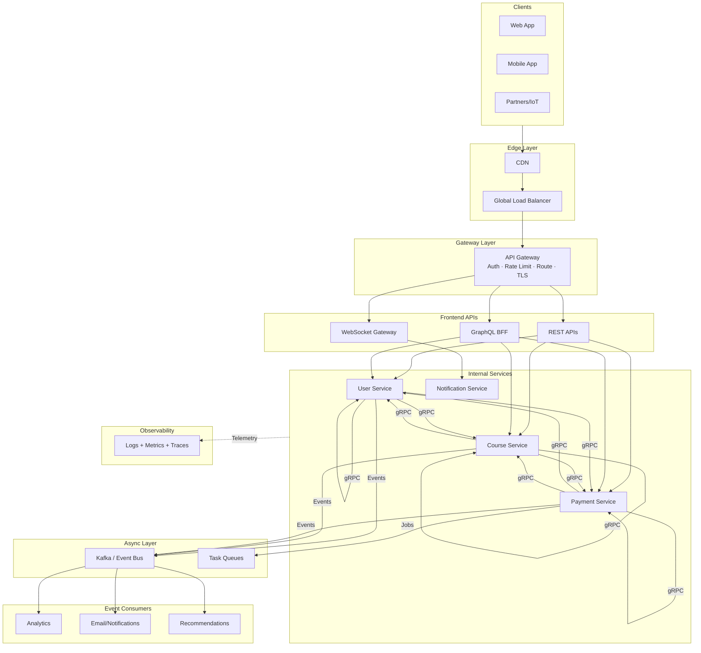

# API Communication: learn through the problem

Start with one learner opening **API Fundamentals**. Follow the request, see what changes when the catalogue grows or a response disappears, and learn which choices address each new requirement.

**[Start the Phase 0 journey](docs/00-GUIDED-FUNDAMENTALS.md)** · **[Find every existing topic](docs/COURSE-CONTENT-MAP.md)** · **[Open the complete original Phase 0 reference](docs/00-FUNDAMENTALS.md)**

## How this course teaches

**Problem → simplest workable approach → detailed example → changed condition → limitation → alternatives and costs → prediction check.**

We keep the learning-platform story across the journey: courses, learners, enrollment, progress, and completion. A new technique earns its place by meeting a requirement; it is not automatically an upgrade. Other domains and specialist concepts remain available through linked lessons and the complete reference.

The evolution-based reading path now covers **Phases 0–4: fundamentals, REST, GraphQL, RPC/gRPC, and real-time communication**. All eight existing phases and both companion guides remain intact. Later phases will be reshaped one at a time, not presented as already rewritten.

**[Continue with the REST journey](docs/01-GUIDED-REST.md)** · **[Read corrections and distinctions](docs/CONTENT-CORRECTIONS.md)**

REST's related lessons provide detailed explanations of [HTTP contracts](docs/lessons/REST-HTTP-CONTRACTS.md), [collections and caching](docs/lessons/REST-COLLECTIONS-AND-CACHING.md), [access and evolution](docs/lessons/REST-AUTH-AND-EVOLUTION.md), and [reliability and operations](docs/lessons/REST-RELIABILITY-AND-OPERATIONS.md). They are part of the course, not disposable extras or short summaries.

**[Compare GraphQL for the same dashboard](docs/02-GUIDED-GRAPHQL.md)**, then follow its related [execution and batching](docs/lessons/GRAPHQL-EXECUTION-AND-BATCHING.md) and [cost, caching, and evolution](docs/lessons/GRAPHQL-COST-CACHING-AND-EVOLUTION.md) lessons. REST aggregation remains a valid alternative; GraphQL is not a required upgrade.

**[Follow the same platform through a typed remote call](docs/03-GUIDED-RPC-AND-GRPC.md)**, with complete related lessons on [protobuf and evolution](docs/lessons/GRPC-PROTOBUF-AND-EVOLUTION.md) and [lifecycle, streaming, and operations](docs/lessons/GRPC-LIFECYCLE-AND-OPERATIONS.md). REST remains valid internally; gRPC does not justify splitting a working application into services.

**[Change the freshness requirement before changing the transport](docs/04-GUIDED-REALTIME.md)**. Related lessons explain [recovery and flow](docs/lessons/REALTIME-RECOVERY-AND-FLOW.md), [webhooks and background work](docs/lessons/WEBHOOKS-AND-BACKGROUND-JOBS.md), [push delivery](docs/lessons/PUSH-NOTIFICATION-DELIVERY.md), and [WebRTC media](docs/lessons/WEBRTC-MEDIA-AND-CONNECTIVITY.md). The site does not run those APIs, request camera access, or require paid services to study them.

The reading path is text-first. Diagrams explain specific exchanges or changes in state; animations and the visual course map are optional. No account, paid tools, or hosted API service is needed.

**Use the examples actively:** make each prediction before opening **Reveal reasoning**. At the end, reconstruct an exchange without looking, change a requirement, and try a different-domain case. The deeper retry and deferred-work lessons remain linked for implementation detail; you do not have to master them before understanding the basic read/write story.

<details class="optional-course-map">
<summary>Explore the optional visual course map</summary>
<course-map>
<div class="cm-fallback">
<p class="cm-eyebrow">THE API COMMUNICATION STUDIO</p>
<p class="cm-fallback-title"><strong>Make systems speak.</strong></p>
<p>API Communication: Zero to Hero. Follow a message from your browser to a distributed system, then learn how to design the conversation. Eight phases, two companion guides, and browser-native visual lessons in Phases 0 and 1.</p>
<p><a href="docs/00-GUIDED-FUNDAMENTALS.md">Start Phase 0: Fundamentals</a> · <a href="docs/00-FUNDAMENTALS.md">Complete original Phase 0 reference</a> · <a href="docs/01-GUIDED-REST.md">Continue with REST</a> · <a href="docs/01-REST-APIS.md">Original REST reference</a> · <a href="https://irfan2772.github.io/API-Communication/">Open the interactive documentation site</a></p>
<p><strong>The learning route</strong> — select a phase on the documentation site to inspect its prerequisites and learning outcomes. All reading material is also available through these links:</p>
<ol start="0">
<li><a href="docs/00-GUIDED-FUNDAMENTALS.md">Phase 0 — Fundamentals</a>: one request, changed requirements, expected outcomes, and trade-offs.</li>
<li><a href="docs/01-GUIDED-REST.md">Phase 1 — REST APIs</a>: one evolving course contract, with complete linked lessons and the original reference.</li>
<li><a href="docs/02-GUIDED-GRAPHQL.md">Phase 2 — GraphQL</a>: compare data shapes, execute typed selections, and account for their cost.</li>
<li><a href="docs/03-GUIDED-RPC-AND-GRPC.md">Phase 3 — RPC &amp; gRPC</a>: typed contracts, message bytes, remote failure, and streaming choices.</li>
<li><a href="docs/04-GUIDED-REALTIME.md">Phase 4 — Real-Time</a>: freshness, direction, recovery, delivery boundaries, and media choices.</li>
<li><a href="docs/05-ASYNC-APIS.md">Phase 5 — Async APIs</a>: queues, event streams, and delivery guarantees.</li>
<li><a href="docs/06-API-ARCHITECTURE.md">Phase 6 — API Architecture</a>: gateways, BFFs, meshes, and backpressure.</li>
<li><a href="docs/08-EXPERT-API-DESIGN.md">Phase 7 — Expert Design</a>: evolution, consistency, and multi-region systems.</li>
</ol>
<p><strong>Companion guides, not extra numbered phases:</strong> <a href="docs/07-SENIOR-DESIGN-GUIDE.md">Senior Design Guide</a> · <a href="docs/09-SYSTEM-DESIGN-CASE-STUDIES.md">System Design Case Studies</a>.</p>
<p>The site enhances this overview with an interactive route map and an illustrative request trace. If JavaScript is unavailable, the links above and all reference material below remain usable. Nothing is tracked or saved.</p>
</div>
</course-map>
</details>

## 📖 What This Repository Is

This is a structured, progressive learning journey through **every major API communication method** used in modern software engineering. It covers the _why_ behind each technology, not just the _how_.

Whether you're a junior developer building your first REST endpoint or a senior engineer designing multi-region event-driven architectures — this guide meets you where you are and takes you further.

---

## 🗺️ Learning Roadmap



---

## 📊 Content Availability

| Phase | Topic                      | Reading material | Document                                                                  |
| ----- | -------------------------- | ------- | ------------------------------------------------------------------------- |
| 0     | Fundamentals               | Available | [00-FUNDAMENTALS.md](docs/00-FUNDAMENTALS.md)                             |
| 1     | REST APIs                  | Available | [01-REST-APIS.md](docs/01-REST-APIS.md)                                   |
| 2     | GraphQL                    | Available | [02-GRAPHQL.md](docs/02-GRAPHQL.md)                                       |
| 3     | RPC & gRPC                 | Available | [03-RPC-AND-GRPC.md](docs/03-RPC-AND-GRPC.md)                             |
| 4     | Real-Time Communication    | Available | [04-REALTIME-COMMUNICATION.md](docs/04-REALTIME-COMMUNICATION.md)         |
| 5     | Async APIs & Events        | Available | [05-ASYNC-APIS.md](docs/05-ASYNC-APIS.md)                                 |
| 6     | API Architecture           | Available | [06-API-ARCHITECTURE.md](docs/06-API-ARCHITECTURE.md)                     |
| 7     | Expert API Design          | Available | [08-EXPERT-API-DESIGN.md](docs/08-EXPERT-API-DESIGN.md)                   |
| Guide | Senior Design Guide        | Available | [07-SENIOR-DESIGN-GUIDE.md](docs/07-SENIOR-DESIGN-GUIDE.md)               |
| Guide | System Design Case Studies | Available | [09-SYSTEM-DESIGN-CASE-STUDIES.md](docs/09-SYSTEM-DESIGN-CASE-STUDIES.md) |

> The [Senior Design Guide](docs/07-SENIOR-DESIGN-GUIDE.md) contains the comprehensive decision framework. The [Case Studies](docs/09-SYSTEM-DESIGN-CASE-STUDIES.md) apply ALL concepts to real-world systems (WhatsApp, Instagram, Netflix, Uber, Twitter, YouTube).

**Reading content is available for all eight phases and both guides.** Interactive visual lessons are being rolled out in Phases 0 and 1; the remaining phases currently use the original reading material and diagrams. This is content availability, not a claim about learner progress or course completeness.

---

## 🎯 Recommended Learning Path

**Start with the [evolution-based Phase 0 journey](docs/00-GUIDED-FUNDAMENTALS.md).** Its linked [complete reference](docs/00-FUNDAMENTALS.md) preserves every original explanation and example. The [topic library](docs/COURSE-CONTENT-MAP.md) keeps material that branches from the main story discoverable.

Then read the [REST journey](docs/01-GUIDED-REST.md). The older REST studio and all its reference material remain available in [Full reference mode](docs/01-REST-APIS.md?view=reference); no original code blocks or examples were replaced by the new journey.

**New in Phase 0:** [Follow a request, explore a decision tree, and visualize a queue](docs/00-FUNDAMENTALS.md). These examples run entirely in your browser, with step controls, optional depth/motion, and text explanations. No accounts, paid tools, or local coding setup are needed.



**If you're starting fresh**, follow this order:

1. Fundamentals → REST (you need this foundation everywhere)
2. GraphQL + gRPC (understand alternatives to REST)
3. Real-Time (WebSocket, SSE, Push, WebRTC)
4. Async APIs (Queues, Kafka, Event-Driven Architecture)
5. API Architecture (Gateway, BFF, Service Mesh, Backpressure)
6. Senior Design Guide (the capstone decision framework)

**If you're a senior dev seeking a refresher**, start with the [Senior Design Guide](docs/07-SENIOR-DESIGN-GUIDE.md) and dive into specific phases as needed.

---

## 🧭 Quick Navigation

### By Topic

| I want to learn about...                   | Go to                                                 |
| ------------------------------------------ | ----------------------------------------------------- |
| What APIs are, basic vocabulary            | [Fundamentals](docs/00-FUNDAMENTALS.md)               |
| REST resources, HTTP methods, status codes | [REST APIs](docs/01-REST-APIS.md)                     |
| Pagination, caching, idempotency           | [REST APIs](docs/01-REST-APIS.md)                     |
| Client-driven data fetching, schemas       | [GraphQL](docs/02-GRAPHQL.md)                         |
| N+1 problem, DataLoader, Federation        | [GraphQL](docs/02-GRAPHQL.md)                         |
| Protocol Buffers, HTTP/2, streaming        | [RPC & gRPC](docs/03-RPC-AND-GRPC.md)                 |
| WebSocket, SSE, long polling               | [Real-Time](docs/04-REALTIME-COMMUNICATION.md)        |
| Push notifications (FCM/APNS)              | [Real-Time](docs/04-REALTIME-COMMUNICATION.md)        |
| WebRTC, STUN/TURN/ICE                      | [Real-Time](docs/04-REALTIME-COMMUNICATION.md)        |
| Kafka, RabbitMQ, SQS                       | [Async APIs](docs/05-ASYNC-APIS.md)                   |
| Delivery guarantees, DLQ, Saga             | [Async APIs](docs/05-ASYNC-APIS.md)                   |
| Event sourcing, CQRS, Outbox               | [Async APIs](docs/05-ASYNC-APIS.md)                   |
| API Gateway, BFF, Load Balancing           | [API Architecture](docs/06-API-ARCHITECTURE.md)       |
| Service Mesh, OpenAPI, Backpressure        | [API Architecture](docs/06-API-ARCHITECTURE.md)       |
| Choosing between REST/GraphQL/gRPC/WS      | [Senior Design Guide](docs/07-SENIOR-DESIGN-GUIDE.md) |
| System design interview preparation        | [Senior Design Guide](docs/07-SENIOR-DESIGN-GUIDE.md) |
| API evolution, backward compatibility      | [Expert Design](docs/08-EXPERT-API-DESIGN.md)         |
| CAP theorem, consistency models            | [Expert Design](docs/08-EXPERT-API-DESIGN.md)         |
| Raft, Paxos, leader election               | [Expert Design](docs/08-EXPERT-API-DESIGN.md)         |
| Distributed transactions, Saga, 2PC        | [Expert Design](docs/08-EXPERT-API-DESIGN.md)         |
| Multi-region, SLI/SLO/SLA, error budgets   | [Expert Design](docs/08-EXPERT-API-DESIGN.md)         |
| API monetisation, multi-tenant             | [Expert Design](docs/08-EXPERT-API-DESIGN.md)         |
| Staff engineer design thinking             | [Expert Design](docs/08-EXPERT-API-DESIGN.md)         |

### By Use Case

| I'm building...          | Read these                                                                                                     |
| ------------------------ | -------------------------------------------------------------------------------------------------------------- |
| A public CRUD API        | [REST](docs/01-REST-APIS.md) → [Architecture](docs/06-API-ARCHITECTURE.md)                                     |
| A mobile app backend     | [REST](docs/01-REST-APIS.md) → [GraphQL](docs/02-GRAPHQL.md) → [Architecture](docs/06-API-ARCHITECTURE.md)     |
| Internal microservices   | [gRPC](docs/03-RPC-AND-GRPC.md) → [Async](docs/05-ASYNC-APIS.md) → [Architecture](docs/06-API-ARCHITECTURE.md) |
| A chat/real-time app     | [Real-Time](docs/04-REALTIME-COMMUNICATION.md) → [Async](docs/05-ASYNC-APIS.md)                                |
| A payment system         | [REST](docs/01-REST-APIS.md) → [Async](docs/05-ASYNC-APIS.md) → [Senior Guide](docs/07-SENIOR-DESIGN-GUIDE.md) |
| An event-driven platform | [Async](docs/05-ASYNC-APIS.md) → [Architecture](docs/06-API-ARCHITECTURE.md)                                   |

---

## 🏗️ Architecture at a Glance

The following diagram represents a mature API communication architecture — the kind you'll fully understand by the end of this journey:



---

## 📐 The Senior Decision Framework

> _A senior engineer does not say: "REST is best" or "gRPC is faster, so use gRPC everywhere."_
>
> \*A senior engineer asks: **Who is calling whom, how often, how quickly do they need a response, how reliable must delivery be, and who controls the client?\***

| Question                                  | If Yes →              |
| ----------------------------------------- | --------------------- |
| Does the caller need an immediate answer? | REST / GraphQL / gRPC |
| Is the API mostly for frontend/mobile?    | REST or GraphQL       |
| Is it internal service-to-service?        | gRPC                  |
| Does the server need to push updates?     | SSE or WebSocket      |
| Can work happen later?                    | Queue / Event Stream  |
| Does another system need to notify you?   | Webhook               |

Full decision framework: [Senior Design Guide →](docs/07-SENIOR-DESIGN-GUIDE.md)

---

## 🏆 Capstone: Real-World System Design Case Studies

The final document applies **everything** from Phases 0–7 to end-to-end system designs:

| Case Study    | What You'll Learn                                        |
| ------------- | -------------------------------------------------------- |
| **WhatsApp**  | WebSocket + Push + WebRTC + Kafka + Multi-region         |
| **Instagram** | GraphQL BFF + Feed Fanout + CDN + Event-driven           |
| **Netflix**   | Multi-region Active-Active + CDN + Chaos Engineering     |
| **Uber**      | Real-time Location + Saga + Matching + Surge             |
| **Twitter/X** | Fan-out on Write/Read + Trending + Rate Limiting         |
| **YouTube**   | Upload Pipeline + Transcoding Queue + Adaptive Streaming |

Plus: How Amazon, LinkedIn, Snapchat, and JioHotstar map to the same patterns.

**[→ Read the Case Studies](docs/09-SYSTEM-DESIGN-CASE-STUDIES.md)**

---

## 📚 Sources & References

This documentation draws from and references:

- _Designing Data-Intensive Applications_ by Martin Kleppmann
- Official documentation: [gRPC](https://grpc.io), [GraphQL](https://graphql.org), [OpenAPI](https://swagger.io)
- RFCs: WebSocket (RFC 6455), HTTP/2 (RFC 7540)
- MDN Web Docs (Server-Sent Events)
- Real-world architecture patterns from Netflix, Meta, Uber, Amazon, LinkedIn

---

## 🤝 How to Use This Repository

1. **Follow the phases in order** if you're building foundational knowledge
2. **Jump to specific topics** using the navigation tables above
3. **Use the Senior Design Guide** as your reference during system design interviews
4. **Each document is self-contained** — you can read any single doc without the others

### Maintaining the visual lessons

The main entry is a plain reading path; the homepage `<course-map>` remains available in an optional disclosure, with real static lesson links. Its native module and scoped styles are `assets/course-map.mjs` and `assets/course-map.css`. The course map selects a lesson preview without navigating; only the explicit lesson link opens it. GraphQL and gRPC branch from REST, while the Senior Design Guide and case studies are companion resources rather than numbered phases. No account, tracking, saved progress, external images, or runtime service is used.

The homepage request trace is illustrative: it does not send an API request. Use Next hop for manual steps or Animate request for one finite walkthrough. Depth view is optional; Static mode and the operating system's reduced-motion preference disable animated walkthroughs. Removing the homepage clears its timer and event listeners. The homepage sidebar prioritizes chapter links instead of expanding the README's section list; the original sections remain below the map. Keep the static fallback links and route metadata aligned with `_sidebar.md` when changing the curriculum.

Run the homepage metadata and route checks with `node --test tests/course-map.test.mjs`. In the browser, check phase selection without navigation, both companion guides, arrow/Home/End keyboard navigation, explicit lesson links, depth/static controls, reduced motion, mobile diagram scrolling, and leaving the homepage during playback.

The site-wide studio and Phase 0/1 visual examples use native browser modules, SVG, and CSS in `assets/`; no framework, paid API, or build step is required. GitHub Pages serves them alongside the existing Docsify site. The original Markdown explanations remain available when the interactive components cannot run. Chapter-specific introductions take precedence over the generic studio banner, so readers see one introduction rather than duplicate heroes.

The Phase 1 `<rest-visual>` scenes cover HTTP resource operations, lost-response retries, and ETag-guarded updates. Their deterministic models are in `assets/rest-models.mjs`. The retry model assumes an atomic local commit of the effect and replay record; it is not real persistence or proof of an external payment guarantee. The editor scenarios show the rejected request **and** a subsequent reviewed recovery, so inspect the intermediate status, not just the final response.

Phase 1 also provides **Guided lessons** and **Full reference**. The guided path follows the six existing Parts: model resources, follow messages, shape collections, make retries safe, reuse/protect state, and operate the contract. The original quick reference and table of contents remain in **Overview & quick reference**. This changes presentation, not the amount of course content: the controller moves existing elements into stage sections without regenerating the explanations, code, or anchors.

The main example stays with one learning platform: course catalogue, learner, and enrollment. Original product comparisons and other domains remain as transfer exercises. The **First REST API Design** walkthrough connects a resource tree, the user's intent, a request, a response, and its effect instead of presenting isolated endpoint boxes.

Stage links use `#/docs/01-REST-APIS?view=guided&stage=1` through `stage=6`; overview is `stage=0`. Full reference uses `view=reference`. Existing `?id=` section links reveal the containing stage automatically, including links from search or another chapter. While reading Full reference, its section links keep that view instead of unexpectedly hiding the rest of the chapter. Invalid stage/view parameters show an explicit warning and the full reference. Position is not a completion score, and no progress or account information is stored.

Guided-reading browser checks: visit all six stages and the overview; compare the full-reference headings/code with the unenhanced source; open an old anchor in a hidden stage; use search and browser back/forward; switch away while a visual is playing; verify that no diagram or copy button loses functionality. At narrow widths and with reduced motion, all stage navigation and text alternatives must remain available. A script-loading failure leaves the original full reference readable.

Mermaid diagrams render in an independent, offscreen measurement surface before their SVGs are inserted into the lesson. This lets hidden guided stages retain correctly measured graphs even if the reader switches stages during rendering. Check every original diagram in both views when changing the stage layout.

Run the deterministic teaching-model checks with a modern Node.js version:

```sh
node --test tests/*.test.mjs
```

For a local preview, serve this repository with a static HTTP server (for example `python3 -m http.server 8000`) and open `http://localhost:8000/#/docs/00-FUNDAMENTALS`. Browser modules require HTTP serving rather than opening the HTML file directly. The model tests do not replace browser checks: verify scenario switching, keyboard controls, reduced motion, mobile layout, and navigating away during playback.

For the new reading journey, open `http://localhost:8000/#/docs/00-GUIDED-FUNDAMENTALS`. Content validation checks the coverage inventory, retained source checksums, local links, and worked-example expectations. UI assessment is manual; no browser automation is required for this content-first rewrite.

The retention baselines in `assets/course-coverage.mjs` cover the ten original chapter files byte for byte; raw-note hashes are also checked. Do not refresh a baseline merely to silence a failure. If a source change is intentional, review its retained topics/examples and destination before updating the manifest. A source-preservation check does not certify that every claim in the old notes is technically correct; the guided lesson states its assumptions and more precise guarantee boundaries.

`assets/rest-reading-map.mjs` assigns each original REST heading to a recommended reading destination while retaining its exact source line and complete original chapter. The [correction record](docs/CONTENT-CORRECTIONS.md) distinguishes clarified or corrected teaching from unchanged historical source. These content checks are not a claim of production readiness or measured learner mastery.

`assets/graphql-reading-map.mjs` does the same for the original GraphQL chapter. The new examples share a typed contract in `assets/graphql-lesson-fixtures.mjs`; it is a validation fixture, not a deployed API.

### Optional maintainer validation for GraphQL examples

The website needs no GraphQL package or backend. Its normal `node --test tests/*.test.mjs` checks remain dependency-free. To additionally parse, validate, and execute the deterministic examples with the official GraphQL engine, install the free validation dependency separately from the repository:

```sh
npm install --prefix "$TMPDIR/api-course-graphql-check" --ignore-scripts --no-audit --no-fund --package-lock=false graphql@16
node scripts/validate-graphql-lessons.mjs "$TMPDIR/api-course-graphql-check/node_modules/graphql/index.js"
```

The validator checks valid documents and deliberately rejected examples, selected responses, null/error paths, backend-call accounting, enrollment/replay/conflict and subscription events. It does not start a server, test browser UI, implement a durable transaction, or prove production throughput. If the dependency is absent, the validator fails explicitly rather than silently skipping checks.

### Optional maintainer validation for protobuf examples

The [shared protobuf contract](docs/contracts/course_api.proto) and
`assets/rpc-lesson-fixtures.mjs` define the canonical Phase 3 examples.
`assets/rpc-reading-map.mjs` retains every original RPC heading's source and
recommended reading destination. No gRPC server, generated client, or protobuf
runtime is required by the website.

For a separate parsing and binary round-trip check:

```sh
npm install --prefix "$TMPDIR/api-course-protobuf-check" --ignore-scripts --no-audit --no-fund --package-lock=false protobufjs@7
node scripts/validate-protobuf-lessons.mjs "$TMPDIR/api-course-protobuf-check/node_modules/protobufjs/index.js"
```

This uses Protobuf.js, not the `protoc` compiler. It checks complete definitions,
method shapes, canonical message round-trips, exact message-prefix bytes,
presence and additive-reader examples. It does not start a transport or prove
durable enrollment, retry safety, cancellation, delivery, or measured performance.

### Optional maintainer validation for real-time examples

The canonical values live in `assets/realtime-lesson-fixtures.mjs`; the
source-heading inventory is `assets/realtime-reading-map.mjs`. The normal Node
tests remain dependency-free. For an additional standards-oriented SSE parsing
check, install its free development-only parser outside the repository:

```sh
npm install --prefix "$TMPDIR/api-course-sse-check" --ignore-scripts --no-audit --no-fund --package-lock=false eventsource-parser@3
node scripts/validate-realtime-lessons.mjs "$TMPDIR/api-course-sse-check/node_modules/eventsource-parser/dist/index.js"
```

The probe checks the actual literal SSE bodies, blank-line dispatch, chunked
input, replay/reset and snapshot cases, WebSocket handshake/masking, and the
published raw-body HMAC example. It does not run a browser, push provider,
webhook receiver or WebRTC engine. Learning and hosting the static course remain
free; operating real notification, TURN or media infrastructure may have costs.

### Course link resolution

Docsify must resolve a lesson's sibling and `../` links relative to that
lesson's directory. The site enables `relativePath`; shared sidebar targets
are rooted at `/docs/` so the current lesson cannot prepend another `docs/`.
Raw HTML `href="#/docs/..."` links remain site routes, including on the
GitHub Pages `/API-Communication/` project subpath. In Markdown, use a lesson
path such as `01-REST-APIS.md?view=reference`, not `#/docs/...`: Docsify treats
a Markdown destination beginning with `#` as a heading link.

Local resource links (`.mjs`, `.txt`, `.json`, and other non-Markdown files)
use physical URLs rather than lesson hash routes, so the app does not append
`.md` to them. Their paths are resolved from the source lesson and retain the
deployment subpath. Known legacy short lesson routes are canonicalized;
unrecognized routes are not redirected to a success-shaped fallback.
Docsify and its search plugin are pinned to the resolver version covered by
the routing checks.

The filesystem destination checks alone cannot prove this behavior: they
previously passed even while Docsify generated root-level routes such as
`#/02-GRAPHQL`. Routing regression checks cover the application's resolution
rules as well as file existence. Reload the page after changing the site
configuration; visual review remains manual.

Browser regression cases for Phase 0:

| Action | Expected result |
| ------ | --------------- |
| Select each request scenario and advance all six steps | Existing course renders, missing course reports 404, lost response leaves the client uncertain despite server success |
| Previous, Reset, Play/Pause, and Depth view | State and controls agree; Reset keeps the selected scenario; playback can be stopped |
| Select each of the five platform features | One choice and one tree branch are selected; reasoning includes an alternative and a cost |
| Start with an empty queue; select Traffic spike and advance five ticks | 24 waiting, 16 completed, 10 rejected |
| Then select Recovery capacity and advance five ticks | 4 waiting, 56 completed, 10 rejected; changing scenarios does not erase the backlog |
| Navigate home during playback, then return | Detached lesson timer is cleared; a fresh lesson starts at step one |
| Use a 390px viewport and reduced-motion preference | No page-level overflow; diagrams scroll in their own regions; automatic playback is disabled but keyboard step controls work |
| Open Menu on mobile; scroll and use Back to top | Sidebar opens; the page returns to the top; reading progress resets |

The reading-progress indicator is native: it does not rewrite the page body or discard navigation/lesson event handlers.

Additional studio and REST browser regression cases:

| Action | Expected result |
| ------ | --------------- |
| Select all eight phases and two guides on the map | Preview updates without navigation; Open lesson uses the correct existing chapter route |
| Run the homepage request animation, then navigate during a second run | First trace stops after four hops; detached map clears its timer and listeners |
| Try all seven HTTP resource scenarios | Correct 200/201/204/400/404 outcomes; rejected requests do not change the stored record; PATCH retains omitted fields |
| Compare unprotected, protected, mismatched-payload, and rollback retries | Two effects without a key; one with a key; mismatched payload gets 409 without an extra effect; aborted work does not consume the key |
| Compare ETag scenarios | Stale/weak guards get 412; a required but absent guard gets 428; reviewed recovery preserves both edits, while the unguarded path loses the first title change |
| Pause REST playback or navigate to another chapter | Playback stops; detached scenes clear their timer and listeners |
| At 390px, open Menu, use search, close with Escape, and click the brand | Drawer state and accessible labels agree; controls do not overlap; brand opens the course map |
| Open the brand from far down a chapter | New home route starts at the top; same-chapter section links still reach their anchors |
| Use Focus, Depth, reduced motion, and Skip to lesson content | Reading controls remain usable, no forced playback, and the skip link focuses the article without changing the route |

The studio uses its own navigation landmark rather than a raw topbar `<nav>` that Docsify could mistake for its app navbar. Keep that isolation and the explicit chapter-scroll handling when modifying the shell. To preview newly edited assets, reload the page; when publishing a changed module or stylesheet, update its resource version in `index.html`.

---

<p align="center"><em>Real systems do not use only one communication method. The expert-level mindset is knowing when to use each.</em></p>
